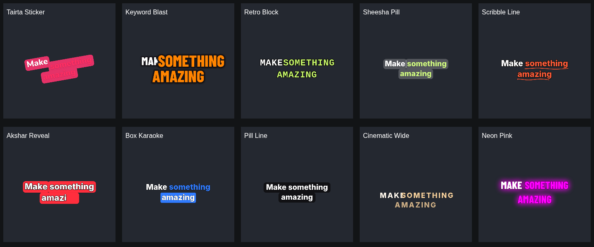
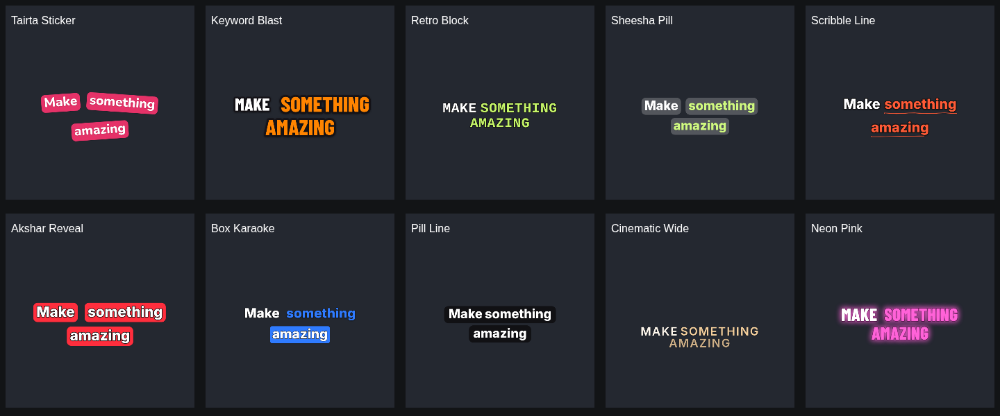

# Extended caption styles: layout and animation repair

The ten extended presets now use measured visual slots in the existing shared Canvas renderer. A slot includes text metrics, tracking, box padding, outline, rotation, built-in overshoot and word-transition movement. The renderer reserves this space for the entire phrase so active-word changes cannot push neighbouring words into each other. Preview, gallery and MP4 export use the same calculation.

## Verified causes and fixes

| Issue | Cause | Fix |
|---|---|---|
| Sticker, Glass, Akshar boxes overlap | Text-only widths and a smaller gap than the box padding | Include full pill footprint in wrapping and spacing |
| Blast keywords cover adjacent words | Emphasis scale applied after placement | Reserve expanded keyword footprint before placing the phrase |
| Retro/Wide tracking overlaps | Tracking set after measurement, using unscaled pixels | Measure and draw with the same resolution-scaled tracking |
| Pill Line overlap/alignment | Background taller/wider than layout; centered independently of text alignment | Include full line pill and anchor it to the aligned line |
| Edge positions and transitions clip | Clamp ignored rotation, motion and scaled boxes | Fit the transformed phrase inside the output safe rectangle |
| Akshar shows future words/breaks Hindi shaping | Future age clamped to zero; each code point drawn separately | Gate on actual start; reveal fully shaped text through grapheme boundaries within the word's real duration |
| Retro varies by device | Courier New absent, falling through to proportional font | Explicit local monospace fallback |

Style polish includes gentler alternating Sticker tilt, readable white Sticker lettering, a controlled Blast emphasis size, quieter Neon glow, finer Scribble underline and lighter Wide typography. Existing saved settings remain intact; new defaults apply when a preset is selected again. Automatic fit changes the effective render size, not the selected font-size value.

Layout is cached per Canvas context and active phrase/style/dimensions. Older canvases without tracking support omit tracking consistently during both measurement and drawing. No model, language, timing, media or export-encoding pipeline changes were made.

## Verification

- `npm run test`: 67 tests pass.
- `npm run build`: TypeScript and production Vite build pass.
- `npm run test:browser`: existing editor workflow, mobile layouts, all 16 templates and real 720p MP4 export pass. Original 9-second sample export retains zero-sample best audio lag and >0.9999999 correlation.
- `npm run test:styles`: actual Chromium Canvas tests: 160 configurations, 1,280 animation frames, no detected text/box intersections or safe-area overflow. Portrait, square, landscape and 1080p dimensions; long Hindi/Hinglish text; font size 100; outline 12; 1/2/3 lines; extreme X/Y settings; per-word and phrase transitions. Tests also check stable layout, no future Akshar text, tracking scale and cached measurements.
- Every new preset exports through the real worker to a 1.5-second H.264/AAC MP4, distributed across portrait/square/landscape outputs. FFmpeg fully decodes all ten. FFprobe checks dimensions, duration and audio. PCM comparisons check equal sample counts, zero best lag, whole-track correlation >0.99 and interior correlation >0.999. The synthetic AAC fixture has codec boundary differences in its first/last 0.2 seconds; interior and full-track fidelity are reported separately.
- Twenty exported frames (0.3s and 0.7s per style) are compared with actual preview frames. Caption-region overlap exceeds 0.93 in this fixture. This is image parity, not a recognition-accuracy metric.
- A real 412px editor viewport applies all ten presets, captures screenshots and checks page overflow. Physical Android/Edge hardware remains untested.

Before/after fixture: `Make something amazing`, the middle word emphasized, rendered on 720×1280. At 0.62s, six adjacent pill intersections across Sticker/Glass/Akshar/Pill Line became zero; the Blast text intersection also became zero. Contact sheets show a later animation frame so all words are visible. They are illustrative; the automated tests exercise multiple frames and scripts.

